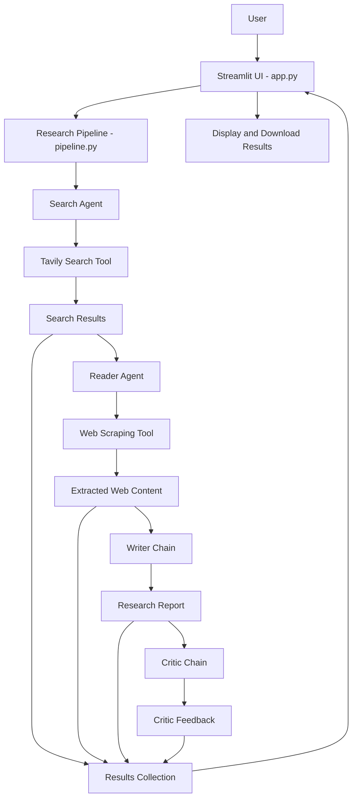

# Multi-Agent Research Assistant Using LangChain

An AI-powered research assistant that automates web research using a multi-agent workflow. It searches for relevant information, extracts webpage content, generates a structured research report, and evaluates the report using an AI critic.

## Features

- **Web Search:** Retrieves relevant sources using Tavily Search.
- **Web Content Extraction:** Extracts useful information from webpages using Trafilatura and BeautifulSoup.
- **Research Report Generation:** Generates structured reports using a Groq-hosted language model.
- **Report Evaluation:** Reviews the generated report and provides feedback on its quality.
- **Interactive UI:** Provides a Streamlit interface for submitting research topics and viewing results.
- **Download Reports:** Exports the research report, critic feedback, or complete research results in Markdown format.

## Project Architecture

The project follows a modular architecture that separates agent logic, tools, pipeline orchestration, and the user interface.

### Architecture Diagram



### Main Components

**1. User Interface (`app.py`)**

- Built with Streamlit.
- Accepts research topics from users.
- Invokes the research pipeline.
- Displays search results, extracted content, the final report, and critic feedback.
- Supports downloading individual outputs or the complete research results.

**2. Agent Logic (`src/agents/agents.py`)**

Contains the agent and chain definitions:

- **Search Agent:** Uses the web search tool to find relevant sources.
- **Reader Agent:** Uses the web scraping tool to extract information from selected URLs.
- **Writer Chain:** Generates a structured research report from the collected research.
- **Critic Chain:** Evaluates the generated report and provides feedback.

**3. Tools (`src/tools/tools.py`)**

Provides external information retrieval capabilities:

- **Web Search Tool:** Uses the Tavily API to search for relevant web sources.
- **Web Scraping Tool:** Extracts webpage content using HTTP requests and HTML content-processing libraries.

**4. Pipeline Orchestration (`src/pipeline/pipeline.py`)**

Coordinates the research workflow in sequential order:

1. Executes the Search Agent.
2. Passes selected source URLs to the Reader Agent.
3. Sends the extracted research to the Writer Chain.
4. Sends the generated report to the Critic Chain.
5. Collects the outputs into a result dictionary for the UI.

**5. External Services**

- **Groq:** Provides the language model used for agent reasoning, report generation, and report evaluation.
- **Tavily:** Provides web search capabilities.

### Data Flow

The system processes a research request through the following sequence:

1. The user enters a topic in the Streamlit interface.
2. The pipeline invokes the Search Agent to find relevant sources.
3. The Reader Agent extracts and summarizes content from selected webpages.
4. The Writer Chain generates a structured research report.
5. The Critic Chain reviews the report and identifies weaknesses.
6. The pipeline returns the collected results to Streamlit.
7. The user reviews the outputs and downloads the report or feedback.

**Note:** The current implementation runs these stages sequentially. The Critic provides feedback on the report, but the pipeline does not automatically revise the report based on that feedback.


## Tech Stack

- Python
- LangChain
- Groq LLM
- Tavily Search API
- Requests
- BeautifulSoup
- Trafilatura
- Readability
- Streamlit
- uv

## Project Structure

```text
Multiagent-Research-Using_Langchain/
├── src/
│   ├── agents/
│   │   └── agents.py
│   ├── tools/
│   │   └── tools.py
│   └── pipeline/
│       └── pipeline.py
├── app.py
├── main.py
├── pyproject.toml
├── uv.lock
├── .env
└── README.md
```

## Installation

### 1. Clone the repository

```bash
git clone <YOUR_GITHUB_REPOSITORY_URL>
cd Multiagent-Research-Using_Langchain
```

### 2. Install dependencies

Install [uv](https://docs.astral.sh/uv/) if it is not already installed.

```bash
uv sync
```

### 3. Configure environment variables

Create a `.env` file in the project root directory:

```env
GROQ_API_KEY=your_groq_api_key
TAVILY_API_KEY=your_tavily_api_key
```

Replace the placeholders with your own API keys.

## Usage

### Run the Streamlit application

```bash
uv run streamlit run app.py
```

Open the local URL displayed in your terminal, enter a research topic, and click **Start Research**.

### Run from the terminal

```bash
uv run python main.py
```

## Example Research Topics

- Recent applications of multi-agent AI systems
- Applications of artificial intelligence in healthcare
- Recent developments in autonomous robotics
- AI agents for automated software development

## Future Improvements

- Add source verification and stronger evidence grounding.
- Implement iterative report refinement based on critic feedback.
- Display real-time progress for each pipeline stage.
- Add research quality metrics and evaluation benchmarks.
- Support exporting reports in PDF format.

## Security

- Keep API keys in your local `.env` file.
- Never commit `.env` or other files containing secrets to GitHub.
- Use a `.gitignore` file to exclude sensitive files and local environments.

## License

This project is intended for educational and research purposes.
